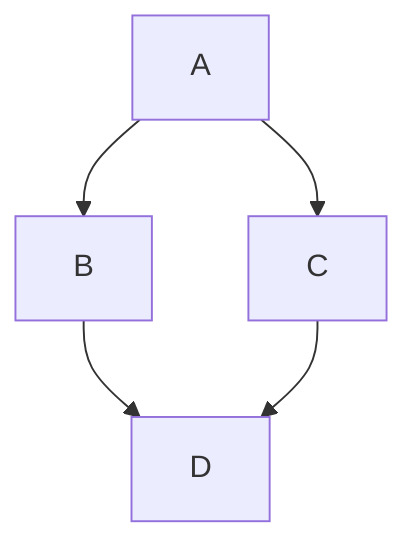

# preview

Render Markdown files locally, with the look of GitHub.

## Table of Contents

- [About](#question-about)
- [Features](#zap-features)
- [Getting started](#rocket-getting-started)
- [Usage](#hammer-usage)
- [Examples](#pencil-examples)
- [Known TODOs / Bugs](#bug-known-todos--bugs)
- [Origins](#pushpin-origins)

## :question: About

**preview** renders Markdown files in your browser the way GitHub shows
them: same stylesheet, dark and light theme, syntax highlighting,
mermaid diagrams, math, task lists, alerts and emoji.  It runs as a
small local web server, watches the files it serves and reloads the
page when they change.  Nothing is sent to GitHub or anywhere else.

It is a fork of [go-grip](https://github.com/chrishrb/go-grip) by
Christoph Herb, see [Origins](#pushpin-origins).

## :zap: Features

- :zap: Written in Go :+1:
- 📄 Render markdown to HTML and view it in your browser
- 📱 Dark and light theme
- 🎨 Syntax highlighting for code
- [x] Todo list like the one on GitHub
- Support for github markdown emojis :+1:
- Support for mermaid diagrams
- hashtag linking in page (see table of contents)
- math expressions (code, inline, block)
- gh issues and prs #46 and grafana/grafana#22
- toggle state is preserved in [sessionStorage](https://developer.mozilla.org/en-US/docs/Web/API/Window/sessionStorage)

This is an inline $\sqrt{3x-1}+(1+x)^2$ function.

$$\left( \sum_{k=1}^n a_k b_k \right)^2 \leq \left( \sum_{k=1}^n a_k^2 \right) \left( \sum_{k=1}^n b_k^2 \right)$$

```math
\left( \sum_{k=1}^n a_k b_k \right)^2 \leq \left( \sum_{k=1}^n a_k^2 \right) \left( \sum_{k=1}^n b_k^2 \right)
```



```go
package main

import "fmt"

func main() {
	fmt.Println("Hello from preview!")
}
```

> [!TIP]
> Support of blockquotes (note, tip, important, warning and caution) [see here](https://github.com/orgs/community/discussions/16925)

> [!IMPORTANT]
>
> test

## :rocket: Getting started

To install preview:

```bash
go install github.com/troglobit/preview@latest
```

> [!TIP]
> The repository is also a [nix flake](https://nixos.wiki/wiki/Flakes),
> so `nix run github:troglobit/preview` works too.

## :hammer: Usage

To render the `README.md` file simply execute:

```bash
preview README.md
# or
preview
```

The browser will automatically open on http://localhost:6419. You can disable this behaviour with the `-b=false` option.

You can also specify a port:

```bash
preview -p 80 README.md
```

By default the server only listens on `localhost`, so it is not reachable from other machines. To listen on a specific interface pass its IP address with `-H`, or use `0.0.0.0` to listen on all interfaces:

```bash
preview -H 0.0.0.0 README.md
```

or just open the folder page for the current directory:

```bash
preview
```

The folder page shows a table of the folder's entries (folders first, with size and modification time) and, if the folder has a `README.md`, renders it below the table, like GitHub does. Every folder you open in the browser gets the same page. Use the arrow keys (or `j`/`k`) to move between rows, Enter to open a file or folder, and Backspace or ← to go up to the parent folder.

To serve another folder, pass it as the argument (with or without a trailing slash):

```bash
preview docs/
```

preview then serves that folder as the root and opens its folder page. A file argument serves the file's folder and opens the file. If the given path does not exist, preview prints an error and exits with status 1 instead of starting the server.

Dark mode is not a launch option: use the toggle in the top right corner of the page. Your choice is stored in the browser's local storage, so each browser remembers its own theme. Without a stored choice the page follows the operating system's `prefers-color-scheme` setting.

Below it, the width toggle (↔) opens a panel to set the content width to 70%, 80% or 90% of the window, to a custom two-digit percentage typed into the field below the options, or back to Auto (GitHub's 896px). Like the theme, the choice is stored in the browser's local storage. The toggle is hidden on windows narrower than 940px, where the content already spans the full width.

By default each open page reloads when something it shows changes: a Markdown page when its file or a local image it references is saved, a folder page when an entry in that folder is added, removed, renamed or written. Saving an unrelated file does not reload the page, and editor temp and swap files are ignored.

To disable automatic browser reload on file changes (useful for stable editing):

```bash
preview --no-reload README.md
```

To disable markdown features in the renderer, use `--disable-markdown-feature`.
Supported feature names are `details`, `footnote`, `ghissue`, `mathjax`, and `mermaid`.

```bash
preview --disable-markdown-feature mathjax README.md
preview --disable-markdown-feature mathjax --disable-markdown-feature mermaid README.md
```

preview logs to stderr. `--log-level` sets how much it prints: `error`, `warn`, `info` (the default) or `debug`. At `info` you only see the startup lines, warnings and errors; `error` hides the startup lines too. `debug` adds a timestamped line for every request (method, path, status, duration), every file system event and whether it was ignored, each debounced reload and how many events it coalesced, and each live reload connection. Attach that output when reporting a reload problem:

```bash
preview --log-level=debug README.md
```

The browser page title is derived from the Markdown filename (`my-guide_v2.md` becomes `My Guide V2`).

To check which build you are running:

```bash
preview --version
```

To terminate the current server simply press `CTRL-C`.

## :pencil: Examples


## :bug: Known TODOs / Bugs

- [ ] Make it possible to export the generated html

## :pushpin: Origins

preview is a fork of [go-grip](https://github.com/chrishrb/go-grip) by
Christoph Herb, a Go reimplementation of the Python
[grip](https://github.com/joeyespo/grip) by Joe Esposito.  grip renders
through GitHub's web API; go-grip, and therefore preview, render locally
with [goldmark](https://github.com/yuin/goldmark) and need no network
access.
